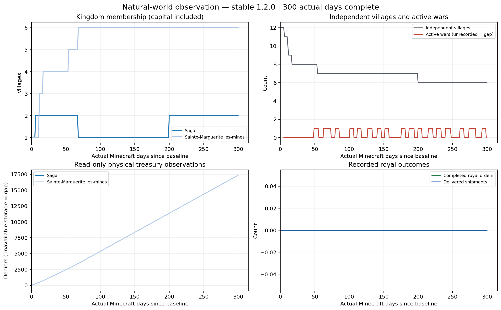
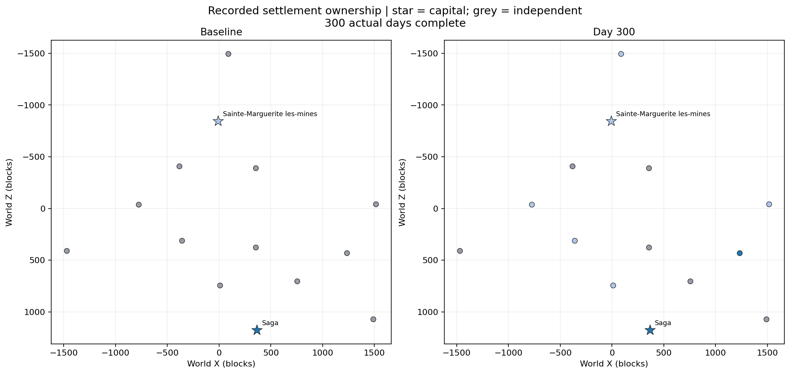

# Natural-world 300-day observation of stable 1.2.0

**Completed:300 actual Minecraft days,7,200,000 elapsed world ticks and301 daily records, followed by normal save/stop and a verified separate-JVM reopen of the same world.** [Final raw evidence, analysis, actual logs and saved native receipts](../verification/1.2.0/natural-300/final-300/). The naturally generated cohort starts with two capitals and twelve independent villages. This observation supplements the earlier focused tests; it does not change the published product. Partial checkpoints below remain historical samples.

## Actual outcome

| Observed event after the baseline | Count |
| --- | ---: |
| Diplomatic incorporation | 6 |
| Wars between the same two kingdoms | 17 |
| Unattended strategic conflicts | 23 |
| Attacker victories / defended conflicts | 9 /14 |
| Village conquests | 1 |
| Peaces | 17 |
| Capital conquests / collapsed kingdoms | 0 /0 |
| New kingdom foundings after the baseline | 0 |
| Paid royal orders / delivered shipments | 0 /0 |

Both original kingdoms survive. All17 wars have ended in peace by day300; no active war remains. A won conflict is counted separately from an actual completed ownership transfer. Native forces in these recorded conflicts were unloaded and used the product's established strategic mode; no physical NPC battle, casualties or loot are inferred.

| Kingdom / native capital Ethos | Initial → final settlements, including capital | Final treasury evidence |
| --- | --- | --- |
| Sainte-Marguerite les-mines / Industrious | 1→6 | 17352 physical deniers; no owed balance |
| Saga / Peaceful | 1→2 (Numazu joined, was lost; Yavapai later joined) | 9048 owed; physical storage remained unloaded/unavailable |
| Independent villages | 12→6 | No fabricated balances |

The Norman realm ends with its capital, Saint-Charles l'abbaye, Marolles la-fôret, Vaucelles la-fôret, Périgny la-montagne and conquered Numazu. Saga retains its capital and Yavapai. The six independent villages are Hagios Antonios, Hagios Stefanos, Hagia Barbara, Hagios Panteleimonas, Ho-Chunk and Teton.

| Actual relative day | Observed change |
| --- | --- |
| 5.075 | Numazu joins Saga; actual logged relation50 |
| 10.075 /11.075 /16.075 | Saint-Charles, Marolles and Vaucelles join Sainte-Marguerite; relations76/50/74 |
| 48.075 | First war, declared by Sainte-Marguerite against Saga at relation−93 |
| 53.075 | Périgny joins Sainte-Marguerite at relation100 |
| 55.075 | First peace; the isolated earlier victory does not transfer Numazu |
| 67.2 | Two victories in the second war transfer Numazu to Sainte-Marguerite |
| 199.075 | Inuit Yavapai joins Japanese Saga at relation100 |
| 298.075 | Seventeenth war ends in peace |

Relative day is `(causal gameTime−22200)/24000`, distinct from the absolute world-day label. Same-tick events retain their causal tick; JSONL append order alone is not used to infer scheduler order.

Figure colors are illustrative; no graphical political-atlas session is claimed.

## What this establishes and what remains unproven

Earlier controlled fixtures establish individual mechanisms on their exact preserved images. This normal-world observation fills the missing evidence that untouched natural settlements can actually incorporate, declare/end wars and complete a village conquest over long real-tick play. It is one seed with two naturally selected capital Ethos types and passive presence at one capital, not statistical coverage of every culture/Ethos/seed or a guarantee of an event by a particular day. Positive relation is eligibility, not certain incorporation: Yavapai had24 recorded eligible pre-round samples, with sampled chance about4.08–4.76%, before its eventual incorporation. These pre-round samples precede relation drift/border and are not counted as proven random draws.

No paid royal economic authorization, commission or shipment happened in this world. Saga's capital/selected targets are unloaded in all301 daily samples. The Norman capital is loaded throughout, but its conditional selected target is loaded in47 samples; current native material/builder/queue/need prerequisites still apply. Metadata intentions are therefore not reported as paid or completed work. The native dataset shows54 higher-level pre-existing building records,8 new complete records and171→193 persistent resident records. These include walls/sub-buildings and resident records; they do not establish54 independently verified physical structures or193 simultaneously loaded living NPCs.

The final long JVM reports **3860 native no-location warnings** (predominantly the Norman church), **1362 native goal-watchdog warnings**, **250 native raid-timeout warnings**, **187 native pathfinding-budget failures** and64 slow waypoint rebuilds. It also reports2958 deferred treasury maintenance attempts at the unloaded Saga capital. The original generation segment has8 native POI mismatch errors. Four measurement/reopen logs contain12 Yggdrasil public-key fetch errors in this offline fixture. These are retained in the [exact categorized audit](../verification/1.2.0/natural-300/final-300/log-audit.json) and full compressed logs; their presence is not labelled harmless or erased. No matching Kingdoms daily-evaluation failure, observer failure or OOM line was found in those logs. The first process interruption remains of unestablished cause.

The outcome demonstrates natural political evolution; it does not justify a claim that all native navigation, building placement, raids or royal economic activity are fault-free. Graphical client behavior, online authentication and native-language review remain separate unverified checks.

## Final persistence and provenance gates

The unchanged baseline is22200; final gameTime/dayTime are7222200, delta7,200,000. Daily records are exactly0–300 with no observation exploration tickets. The last JVM validates7,099,829 successive ticks after100,171 elapsed ticks already present in the saved resumed world. Its measured observation segment lasts29901.44wall seconds (8h18m21s); the earlier interrupted segments/gap are excluded from that duration. This is not represented as one uninterrupted JVM.

Both final actual Gradle server processes exit0 with `BUILD SUCCESSFUL` and all-dimensions-saved logs. Reopen observes tick7222201, booked day300 and66 historical events, including the two pre-baseline foundings. The entire decoded political saved-data object, all23 military receipts and actual memberships match the retained day300 native saved sample. Exactly one military receipt has transferred=true. Original gameplay configuration values and both product/native JAR hashes are rechecked unchanged. There is no invented GameTest `All N required tests passed` line: these are observed normal-server lifecycle results.

The addon is still the published tag commit `f31801644b724c58581c69f73b1cd0a23a3d785f`; observation changes are test tools, evidence and documentation on the existing feature branch. A final GitHub readback found PR3 had already been merged upstream on2026-10-26T21:45:08Z, before this observation, into main `388dba0af9745d4ba4b0186ab56f5f1b25f62038`. This work neither changes main nor merges/replaces that PR. Earlier progress notes describing an open PR/pre-merge main are historical.

## Why this observation is separate

Earlier tests cover individual political, construction, payment, shipment, native military and restart mechanisms. RC.9's 40 paired packages and the later focused gameplay/prose packages retain their exact tested images and required-test pass lines. Earlier calendar simulations explicitly advanced the clock and used controlled fixtures. The native unattended war demonstration explicitly started with hostile relations. Those results do not establish what naturally generated settlements with untouched initial relations will do over 300 full Minecraft days.

## Immutable product under observation

- Stable addon: `releases/1.2.0-final/millenairekingdoms-1.2.0.jar`, SHA-256 `b7ae9fc2f208588962bac8739021b4e4169322443d475b65c672791a53a3e8dd`.
- Release tag commit: `f31801644b724c58581c69f73b1cd0a23a3d785f`.
- Separate original Millénaire9.0.3, SHA-256 `5882528027ac67e8759db3926ebef36abe2300029526582f80c7a988b583ec62`.
- Java21, Minecraft1.21.1, NeoForge21.1.259. The usual GameTest mod is absent: it disables scheduled systems for its isolated fixtures and would invalidate this observation.
- A separate small observer mod records state and supplies passive exploration presence. Production addon/dependency classes, the stable release, cloud configuration, setup script and startup instructions are unchanged.

## World and cohort

Fresh world `run/natural-300-world-03`, seed **20261027300**, normal Overworld terrain, normal difficulty and vanilla structure generation enabled. The original native generation queue alone chooses village types, locations, villagers and initial resources. The unchanged addon applies the default10% natural-capital draw and1000-block capital spacing. Ethos is derived from naturally selected capital types.

Exploration continues until there are at least two naturally founded capitals and twelve independent non-hamlet villages, with at least two independent neighbours within2000blocks of each of two capitals. No village/capital creation command, manual membership, hostility, reputation, coin, material, NPC, construction completion or victory is injected.

Millénaire's built-in embedded test player supplies passive presence. Because an embedded connection has no graphical client driving a normal chunk view, the observer temporarily maintains a17×17-chunk exploration window through test-only region tickets. These chunks use ordinary normal terrain generation and `ChunkEvent.Load`; the observer never calls the native village spawner or capital selection helper. All observer tickets are removed before the baseline. During measurement, a passive invulnerable creative observer remains at one natural capital; original native activation manages village chunks. Other settlements load/unload according to original distance rules. This is a server observation with a mock connection, not an authenticated graphical-client test.

## Clock and records

Vanilla `tick sprint` accelerates wall time. The observer checks every successive gameTime and dayTime increment; it never calls `/time`, sets a clock, invokes a daily scheduler, selects random political outcomes or changes gameplay probabilities. The target is **7,200,000 consecutive actual ticks after the baseline**, exactly300full Minecraft days. Construction, resource consumption, cargo timers, daily decisions and cooldowns retain their original tick/day schedules.

The dataset records baseline, daily snapshots, generated village identities, kingdom membership, Ethos, village relations, loaded/active state, resident records, native building levels/status, wars, raids, conditional economic plans, paid orders, shipment states, available physical treasury or its explicit unavailable reason, owed income and actual Chronicle events. Resident records are not labelled as simultaneously loaded NPC entities. A zero event count is not treated as success or failure without inspecting its real eligibility conditions.

After completion, the server must save and stop, then reopen the same world in a separate JVM. The observer checks persisted capitals, membership, the booked day and historical event count. This is an observational lifecycle gate; no fabricated `All N required tests passed` line is emitted and no GameTest success is inferred from Gradle build success.

## Actual cohort, interruption and continuation

The baseline was established at gameTime/dayTime **22200**, after72 exploration stops. Natural capitals are **Sainte-Marguerite les-mines** (Norman artisan, Industrious) and **Saga** (Japanese agricultural, Peaceful). Their natural centre plan levels are9/9 and6/6 respectively. No probability, resources, relationship or Ethos was edited to obtain them. The normal `minecraft:noise`/`minecraft:overworld` generator, enabled structures/daylight/mob spawning and default randomTickSpeed3 were verified from the actual `level.dat`.

The first measurement process ended before completion. Its final daily record was relative day1; the saved world clock was61571, corresponding to39371 elapsed world ticks. Political day2 and the two original capitals/native village identities were retained. Its cause is not established by stdout, and this segment is not a passing300-day result. The entire stopped world was archived and every file verified before continuation; archive SHA-256 `d10386c9e7d2bff658fddc9eeabfae105feb4e6810f63fd278d96d69f041a014`. The original world remains in place.

A detached continuation loaded that same saved world without changing either clock and recorded days2–4. A requested normal save/stop checkpoint at gameTime/dayTime122371 retained100171 elapsed ticks and political day5, with `BUILD SUCCESSFUL` and all-dimensions-saved logs. Only the observer was updated; the stable addon and native JAR remain unchanged. The continuation retains the original baseline and7,222,200 final world-tick target. Earlier fractional progress is identified through saved clock receipts; per-tick checks continue from each saved clock. Wall time reported by a resumed JVM covers that JVM segment, not the interrupted wall-time gap.

Inspection also found an observer serialization defect: early `wars`/`activeRaids` collection views serialized as null. Those raw early samples remain intact and are treated as unavailable, not silently converted to zero. The observer now records concrete lists. A read-only pre-decision record also captures actual eligible joining targets/chances and native blockers before each scheduled political day; this additional eligibility coverage starts after the early checkpoint. Full event history and the earlier daily relationship samples retain their original scope.

The current detached runner writes to `/workspace/royal-decree/natural-300/attempt-05/`. Each newly completed observation day now requests normal `save-all flush` before recording its daily snapshot. A requested pause saves/stops normally; the same original saved clocks and village identities are validated before resuming. This does not skip time or replace original scheduled decisions. Measured wall cost varies with native activity, from roughly75–80seconds early to110–140seconds per full Minecraft day around day50; several hours are required for300 actual days under this regime. No early final result is substituted.

## Retained preflight problems

The first preflight showed that the embedded test player did not load a surrounding client view. A second preflight showed that transient full-chunk lookups expired before the original post-tick spawn queue could use the complete area; native diagnostic logging confirmed `chunks not loaded` deferrals. Both stopped before any measurement baseline, and neither counts as a passing observation. The first also stalled in vanilla chunk unloading during shutdown; its thread dump and forced termination are retained. Their worlds and raw captures remain preserved. The final attempt has its own capture directory, avoiding the shared capture paths used during preflight.

The correction is confined to observer exploration residency. The final world's native/addon gameplay settings remain at defaults. The actual completed dataset, elapsed-tick proof and separate-JVM reopen are now retained above; the preflights remain failed/non-final attempts.

## First observed outcome (partial checkpoint)

At gameTime144000 (world day6; relative observation day5.075), Numazu autonomously joined Saga. The unchanged AutonomyService log records relation50; the immediate pre-round observer records a probability of approximately0.031. The Chronicle has the same village/realm/causal time. [Day7 raw checkpoint](../verification/1.2.0/natural-300/checkpoint-007/) preserves the actual evidence. This is an early observation, not a300-day completion claim.

By relative day20, four genuine incorporations are recorded: Numazu→Saga, Saint-Charles l'abbaye/Marolles la-fôret/Vaucelles la-fôret→Sainte-Marguerite les-mines. [Day20 raw checkpoint and native save sample](../verification/1.2.0/natural-300/checkpoint-020/) retain the data. Source/evidence commits are `8a76dd9` and `e610ff5`. The original temporary segment04 observer was reconstructed and its full JAR hash matched the recorded launch hash exactly; its image and source are now preserved alongside the other observer revisions.

A read-only sidecar captures native/political saved-data samples after daily flushes, starting at day11. These are individual saved-file samples with explicit non-atomic cross-store receipts. A separate report preparer waits for the real300-day marker, same-world reopen, **both actual JVM exit0 results** and301validated daily rows before creating final review artifacts. It does not publish, commit, alter gameplay or claim completion early.

## First natural war (day50 partial checkpoint)

[Day50 raw checkpoint and analysis](../verification/1.2.0/natural-300/checkpoint-050/) preserve51 daily rows /1,200,000 actual elapsed ticks. The same two kingdoms remain alive with4 and2 members respectively;8 villages remain independent. At world day49 (relative day48.075, gameTime1176000), Sainte-Marguerite les-mines autonomously declared war on Saga at relation−93. At tick1179000 its Vaucelles→Numazu unattended attack won using original strengths60/96 and actual opposed dice17/9 with modifier−4. This is the intended strategic mode for unloaded NPC forces, not a claimed physical NPC battle or invented casualties.

The retained day50 political NBT independently contains that operation's exact WON receipt, transferred=false and campaign progress1/2. Two wins are required in this kingdom war; neither the event nor the first victory is counted as a conquest. Membership is still unchanged by military action at this checkpoint.

No paid royal commission or delivered shipment is recorded by day50. Persistent strategy samples are conditional metadata intentions: Saga's capital/targets are unloaded in all51 daily samples; the Norman capital is loaded, while its selected target is loaded in9. These samples alone do not prove all execution prerequisites or a defect. Ordinary native work does progress:33 pre-existing building records have higher levels and8 new complete records appear (including wall/sub-building scope); persistent resident records change171→196. These counts are separate from royal commissions and loaded living-NPC counts.

The read-only decision analyzer retains the exact pre-round eligibility opportunities and strategy reasons. Those opportunities are captured before daily relation drift/border, not at each random draw; joining is limited to one success per kingdom per round. This avoids treating a positive relation, conditional plan or won battle as guaranteed incorporation, paid construction or ownership transfer.

## First natural conquest (day100 partial checkpoint)

[Day100 dataset, native receipt and partial figures](../verification/1.2.0/natural-300/checkpoint-100/) preserve101 daily rows /2,400,000 actual ticks. Périgny la-montagne joined the Norman kingdom at relation100 on world day54 (relative day53.075). This brings genuine diplomatic incorporations to5, with7 villages still independent.

Three wars and three peaces occurred by day100. Five unattended strategic conflicts produced four attacker victories and one successful defense. At tick1635000 (world day68, relative day67.2), Numazu actually changed from Saga to the Norman kingdom after two wins in the second war. The Chronicle, daily membership and retained native political NBT agree on the exact transferred=true receipt. An isolated win in the first war did not shortcut the new campaign. No capital has fallen by this checkpoint.

Sainte-Marguerite les-mines holds6 villages including its capital and5352 physical deniers. Saga holds only its capital; its3048 owed income is not counted as available physical currency. No paid royal order, shipment or economic authorization is recorded. Fifty-four pre-existing native building records have higher levels,8 new complete records appear and resident records change171→194, retaining the earlier wall/sub-building/living-NPC scope limits. The first100days establish genuine natural incorporation, war, defended/won unattended conflict, village conquest and peace in this seed; the remaining200days and final same-world lifecycle still have to run.

## Day200 partial checkpoint

[Day200 original data and analysis](../verification/1.2.0/natural-300/checkpoint-200/) preserve201 daily rows /4,800,000 actual elapsed ticks. Counts are6 diplomatic incorporations,11 wars,10 peaces,19 strategic battles and1 village conquest. Yavapai autonomously joined Saga at relation100 on world day200 (relative day199.075). Norman membership remains6; Saga recovers to2;6 villages remain independent. No capital conquest or collapse has occurred by this sample.

Norman physical treasury is11352 deniers; Saga's5848 owed income remains distinct from unavailable unloaded physical storage. No paid royal order, shipment or economic authorization is recorded. Fifty-four pre-existing native building records have higher levels,8 new complete records appear and resident records change171→192, with the same earlier scope limits. The same server continues without a checkpoint stop; the remaining100days and final normal stop/reopen must still complete.
