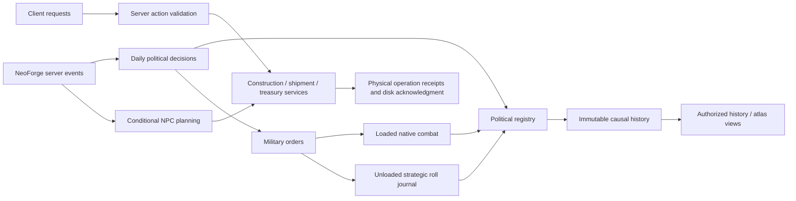

# Current architecture and safe modification guide

Applies to 1.2.1, based on original Millénaire 9.0.3/Minecraft 1.21.1/NeoForge 21.1.259/Java 21. [Baseline audit and tradeoffs](1.2.1_ENGINEERING_REVIEW.md). The longer 1.2.0 architecture/progress files retain historical checkpoints; their old planned/unimplemented labels are not current implementation status.

## Authority and boundaries

| State | Owner | Readers / execution boundary |
| --- | --- | --- |
| Original villages, residents, buildings, native projects and inventories | Millénaire VillageSavedData/native objects and chunks | Adapters read the original 9.0.3 API; native builders/combat retain physical work. |
| Kingdom identity, membership/revisions, rulers, wars, campaign wins, income day ledger | KingdomSavedData | Publishes validated immutable state replacements. Retirement and causal history hooks belong to this boundary. |
| Political decisions | KingdomDay / AutonomyService / DiplomacyService / Military | Registered native metadata supports unloaded settlements; probabilities never bypass permissions/readiness. |
| Physical money | RoyalTreasurySnapshot/Image/Persistence plus RoyalPaymentService/Journal | Quotes require loaded actual storage/current authority; durable operation/container receipts govern recovery. Owed income is not spendable coins. |
| Construction mandate | RoyalConstructionService/Store/Monitor/Runtime | Authorization/payment/queue identity precede native work; physical completion is acknowledged separately. |
| Cargo and delivery | RoyalShipmentService/Store/Runtime/Persistence | Fee, goods escrow, per-container movement and cancellation proofs retain original identities. |
| NPC economic intention | RoyalStrategyService/Store and RoyalNpcRuntime | Conditional metadata plans, not promised resources or completed construction. Loaded current physical validation precedes paid execution. |
| Military operation | RaidOrderService, ConquestService, StrategicBattleService/Store | One original order owns either native dispatch or a committed strategic roll. Political receipts alone grant campaign credit. |
| Historical facts | HistoryHooks/Recovery/Store | Causal UUIDs and immutable names/facts; no retroactive invented founding dates. Presentation never changes stored facts. |
| Discovery and atlas presentation | HistoryVisibility, AtlasViews/Colors | Authorized native settlements and durable colors; no ocean scanner/geometry worker. Old cache bytes are not reclaimed. |
| UI/network | KingdomActions/Screens, payload codecs, client package | Bound requests and main-thread server revalidation. Client snapshots/prices are not authority. |

These are responsibility boundaries, not a claim of an acyclic implementation. The baseline has a broad explicit package-reference cycle. In particular, political publication knows retirement/history hooks, financial protocols share exclusion guards, and server GUI adapters call domain services. Extract narrow ports/read models later without introducing another authoritative database or changing publication order.

## Event ordering and work budgets

MillenaireKingdoms is the composition root. KingdomDay checks every 20 ticks and books a new day once, then income/relations/NPC politics/founding run in their documented order. Raid orders and strategic recovery check every 50 ticks. Construction uses HIGH before native slot selection; shipment tracking uses LOWEST. NPC economic scheduling uses HIGH and configured round robin. Treasury maintenance uses LOWEST, configured new-work cadence and separate 200 tick recovery.

Budgets limit inspected jobs; they do not make an individual saved-chunk acknowledgment cheap. Sorting/index scans precede some budgets. All world/entity/inventory access remains on the legitimate game thread. Do not move these objects into an asynchronous task. Any future async durability design needs immutable snapshots, explicit acknowledgments and stale-state revalidation.

## Physical and strategic military lifecycle

1. Daily policy may authorize one eligible conquest order per NPC kingdom, retaining source/target/current campaign and due/expiry ticks.
2. If either region is loaded, original native dispatch/readiness owns the path. Partially loaded participants do not trigger an artificial strategic substitute.
3. If both regions are unloaded and no physical/native commitment owns the forces, current native records provide bounded positive attacker/defender capability. Independent targets must still be nearby, hostile, unowned and free of local player control.
4. Exact opposed dice and native snapshots persist before political effects. The existing political campaign grants one receipt, with 1 victory for an independent village or 2 within an active kingdom war. Capital majority/collapse rules remain unchanged.
5. SavedData write/readback precedes a truthful Chronicle and terminal acknowledgment. Recovery reuses the exact roll/ID, including an already committed operation past its original dispatch window. New expired orders are rejected before scheduling; their last real blocker is retained in diagnostics.

Independent defenders have a village identity and no invented kingdom UUID. Their Chronicle contains the real attacker realm and native source/target places; localization names the winning side correctly. No strategic operation claims physical deaths, loot, equipment loss or newly spawned soldiers.

## Finance and cross-file durability

Payment intent, actual chunk inventory, native village metadata and operation journals do not share a filesystem transaction. PREPARED/PAID/COMMITTED and refund/recovery states are necessary evidence, not redundant status flags. RoyalTreasuryImage binds before/after slot images, container identity and operation receipts; readback verifies actual saved chunks. Later legitimate native inventory changes must survive recovery. Unknown/unreceipted images are quarantined rather than guessed.

RoyalEconomicReservations and the capital lock prevent overlapping new money/cargo/consolidation images. These checks are deliberately shared across protocols. Consolidation conserves value in one chest per operation, with its own immutable intent/archive. New maintenance skips a cold capital quietly; existing recovery continues separately, even with new maintenance disabled. Loaded partial/missing storage and real integrity failures retain diagnostics. Synchronous commit latency remains a measured limitation; no safety barrier was removed for a benchmark.

## Persistence and compatibility

| Format |1.2.1 policy |
| --- | --- |
| Native 9.0.3 data | Original dependency and serializers unchanged |
| Political registry 7 / HistoryEvent 1 | Existing supported readers/identities retained |
| Strategic war operation 1 | Actual 1.2.0 file roundtrip fixture; no rewrite/migration required |
| Strategic independent operation 2 | New explicit record; nullable defender owner and absent war UUID; strict fields and frozen dice |
| Payment 1 / construction order 5 / recovery audit 2 / shipment 1 | Unchanged financial/native protocols |
| AtlasColors 1 and existing discovery | Retained bytes/visibility rules |
| Network 11 | Matching 1.2.1 clients/servers required for new independent-history semantics; payload layout remains bounded |

Whole-world backups precede upgrades. Reading old supported data is tested; downgrading a world containing new independent military records to 1.2.0 is not supported. Future/corrupt files must remain byte-preserved and block unsafe replay. Do not delete old journals, pending evidence or incompatible fields to obtain a passing test.

## Tests and contributor workflow

[CONTRIBUTING](../CONTRIBUTING.md) gives actual build and selected isolated-pair commands. Domain tests deliberately control fixtures/rolls to test both outcomes and durable cuts. The original-native independent fixture separately spawns original villages/NPCs, removes its setup tickets and observes ordinary scheduler/default RNG decisions with zero players and real ticks. These are distinct from the preserved natural 300-day 1.2.0 observation and from graphical/online checks.

Keep benchmark scope explicit: cold 5/50/500-capital metadata scheduling is not 500 populated villages or live inventory TPS. Useful treasury conversion measures the actual synchronous native-chunk durability path. Exact source/image hashes, failed attempts, pass lines and reopen receipts belong in verification, with the final engineering review recording limitations and deferred 1.3 work.
